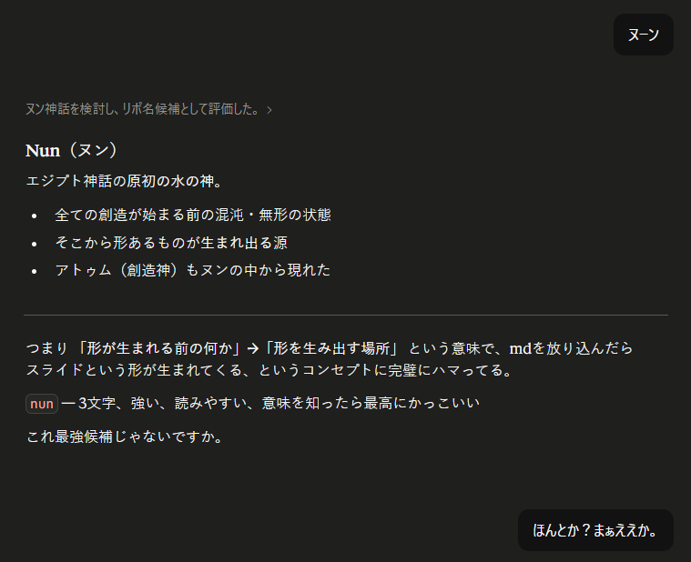

# へのへ Nun

Markdown でスライドを書いて HTML / PDF で出力し、GitHub Pages で公開する俺俺スライド置き場。
中身は純粋な [Marp](https://marp.app/) (marp-cli + 自前テーマ)。

- 名前はうめき声とエジプト神話から。



## 使い方

```bash
vp install
vp run dev       # marp -s benben。/ にデッキ一覧、/<deck>.md でプレビュー (?pdf で PDF)
vp run build     # dist/<deck>.html + 画像・一覧ページ
vp run pdf       # dist/<deck>.pdf
vp check         # 整形・lint・型チェック
```

## 書き方

- `benben/<deck>.md` に Marp 標準記法で書く。front-matter に `theme: nun`
- 画像・SVG は `benben/images/` に置き、相対パス (`images/...`) で参照
- リンク入りの SVG は `<object data="images/..." type="image/svg+xml"></object>`
- class: `title` / `solo` / `message` (`<!-- _class: solo -->`)。`header` は右下、`footer` は左下に出る
- 溢れるスライドは `<style scoped>section { font-size: 28px; }</style>` で縮める
- デッキを足したら `public/index.html` に 1 行追記
- main に push すると GitHub Actions がビルドして https://henohenon.github.io/henohe-Nun/ に公開

## ドキュメント

- [Marp 移行の設計](docs/superpowers/specs/2026-10-03-marp-migration-design.md)
- [Marp 移行検討メモ](docs/journal-2026-09-29-marp.md)
- [競合比較・技術選定](docs/comparison.md)
- 旧実装 (独自 unified パイプライン) の仕様は [docs/archive/](docs/archive/)、コードはタグ `nun-v1`
