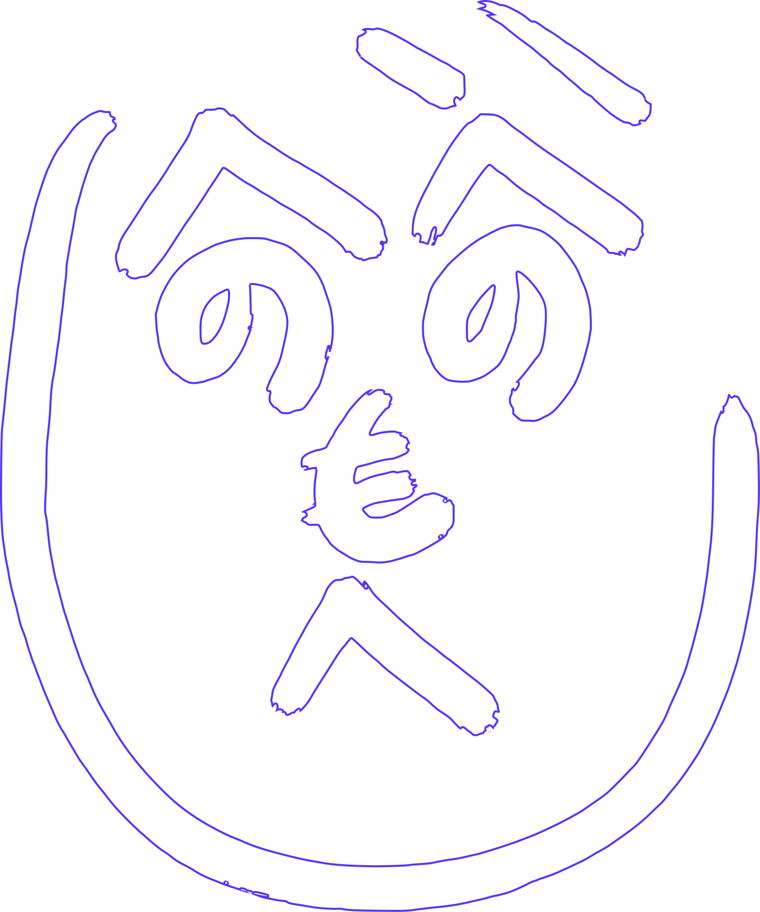

# Quaver

<!-- _class: title -->

QRコードでなんか音を出すやつ

---

# 経緯

## キッカケ

- そろそろゲームから広げたかった
- 紙製品いいな、、、

## ARオルゴール、これや！！！

作ってみた。ピクセル色からなんか取るようなの
→なんか謎の騒音が出るアプリ。微妙だった。

動体検知とかすればいけそうな気はしないでもないが、もうちょい絞るか

## QRローダー

[dotvoice](https://aidn.jp/dotvoice/)

コレとかみてて思いついた。今日の1時ぐらいから稼働開始。
クソ雑な仕様書aiに書かせてclaude codeに投げた。
なんか比較的それっぽくなった！

---

# かいはつひわ

## 技術スタックとか

threejsとtonejs、opencvとかのなんか一般的なスタック

## QR overlay AR

個人的な趣味で前ポートフォリオに実装してた結構レアなやつ。
何人かやってる人はいそうだが、当時調べた限りはあんまり前例なかった(必要とするライブラリが色々複合だから？)

## ロゴ

claude design初めて使ってみた。uiのモック生成とかごまかす性能はありそうだったがあんまりいい感じはしなかった
いくつかの元ネタを元に自分で修正した。Qと♪と~を組み合わせてカワイイをイメージした。

---

# 所感

## よかった

バチ焦りノリ爆速モック開発だったが、一番成果真っ当な気がする。
やっぱりAIのごまかし性能はすごい。こういう使い方が一番合ってる気がしてきた。

## ぷろだくと

悪くないけどあと一歩足りない。
url 先 fetch して ai キャラ生成、 図鑑系の拡張とか?
もうちょい日常に結びつけたい。

## はんせい

もっと余裕を持って作りたい。
スライド作るの時間かかるから、ai自動化を追加したい。
