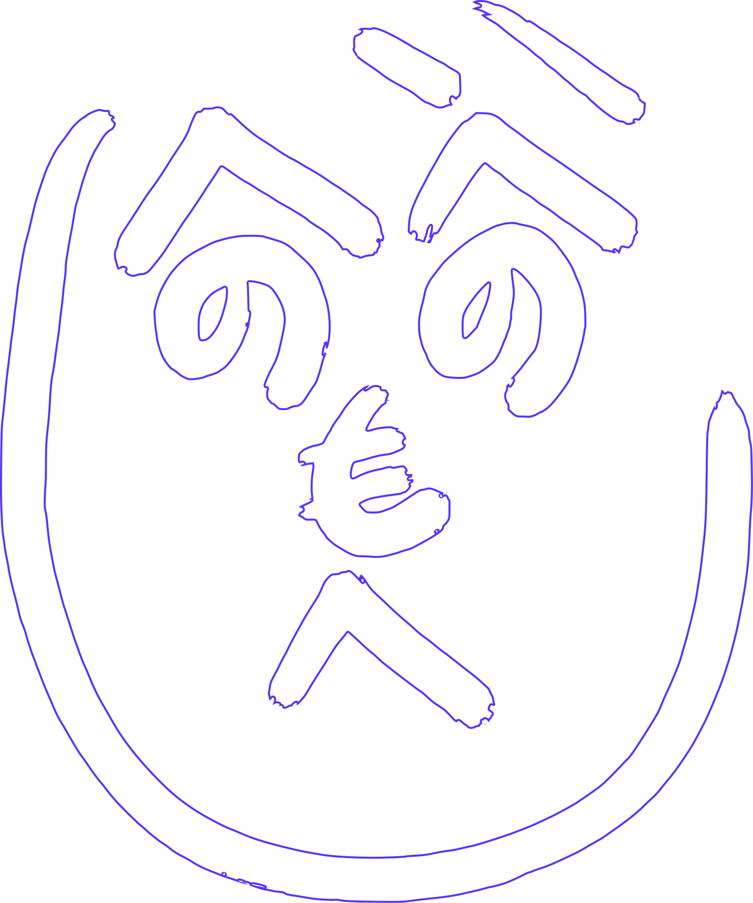
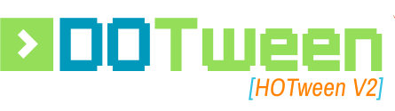

# Web技術でイイ感じのゲーム開発

<!-- _class: title -->

---

# 普段、どんな技術でゲームを作りますか？

<!-- _class: solo -->
<!-- footer: 茶番 -->

---

<object data="images/cool-game/logo-map-1.svg" type="image/svg+xml"></object>

---

<object data="images/cool-game/logo-map-2.svg" type="image/svg+xml"></object>

---

<object data="images/cool-game/logo-map-3.svg" type="image/svg+xml"></object>

---

<object data="images/cool-game/logo-map-4.svg" type="image/svg+xml"></object>

---

<object data="images/cool-game/logo-map-5.svg" type="image/svg+xml"></object>

---

<object data="images/cool-game/logo-map-6.svg" type="image/svg+xml"></object>

---

<object data="images/cool-game/logo-map-7.svg" type="image/svg+xml"></object>

---

<object data="images/cool-game/logo-map-8.svg" type="image/svg+xml"></object>

---

# イチオシ

<!-- footer: 今回の -->

<object data="images/cool-game/lib-row.svg" type="image/svg+xml"></object>

---

# 推しポイント

**圧倒的な開発体験と、十分なクオリティ**

開発体験

- 快適な環境
- 豊富な資産

クオリティ

- パフォーマンス
- グラフィック

---

# 比較対象

<object data="images/cool-game/unity.svg" type="image/svg+xml"></object>

---

# 快適な環境

<!-- _class: solo -->
<!-- footer: "" -->

---

# 環境構築~初回起動

<!-- footer: 快適な環境 -->

- Unity
  - UnityHub, UnityEngine, VisualStudio
  - Create Project, Resolving Packages...
  - 2時間ぐらい
- 今回の
  - pnpm, VSCode, package.json + `pnpm i`
  - `pnpm run dev`, localhostを開く
  - 5~30分

---

# Package Manager

Unity

- UPM — GUI か manifest.json 手編集。
- NuGetForUnity — Editor メニューから。
- (Asset Store — ブラウザで購入 → My Assets から Import)
- →いずれも導入後、Editorが固まる

今回の

- `pnpm add <package>` 一発
- CLI が一次導線 = CI にもそのまま書ける

---

# Dev Loop

- Unity
  - エディタに戻る → 再コンパイル + ドメインリロード
  - 数秒〜数十秒
- 今回の
  - 保存した瞬間、Vite が変更されたモジュールだけ差し替え (HMR)
  - 数ms

---

# CI・CD

- Unity
  - スクリプトに対しては簡単に可能
  - 最近ようやくコマンド1発でビルドできるようになった。
    - ライセンス認証+Dockerまたはオンプレ環境が必要。
    - キャッシュも効かせて時間も20分~数時間ぐらいかかる。

- 今回の
  - 本家本元。皆様ご存知の通り。

---

# 補足: もっと早いエンジンもあるよ！

<!-- footer: "" -->

<object data="images/cool-game/fast-engines.svg" type="image/svg+xml"></object>

- インストール~初回起動
  - 30分~1時間
- ビルド/CDも早くGithub Actionsとかでも現実的

"今回の"も間違いなく最強の一角

---

# 豊富な資産

<!-- _class: solo -->

---

# 数字で見る

<!-- footer: 豊富な資産 -->

|                   |   Unity | three.js | PixiJS | Babylon.js | 3つ合計 |
| ----------------- | ------: | -------: | -----: | ---------: | ------: |
| Stack Overflow    |  76,787 |   20,869 |  1,033 |        465 |  22,367 |
| Reddit            | 402,474 |   28,918 |    804 |      1,127 |  30,849 |
| Qiita             |  18,850 |    1,128 |     17 |        155 |   1,300 |
| Zenn              |   4,456 |      491 |     61 |        210 |     762 |
| GitHub リポジトリ |  38,286 |   20,477 |  1,493 |        696 |  22,666 |

まぁ負け

---

# パッケージ数

| レジストリ        |    登録数 | 範囲                           |
| ----------------- | --------: | ------------------------------ |
| npm               | 4,408,253 | JS / TS 全般                   |
| NuGet             |   488,198 | .NET 全般                      |
| Unity Asset Store |   124,583 | 92% が有料、非コード資産を含む |
| OpenUPM           |     3,993 | Unity の OSS のみ              |

理論上10倍！

---

# 文脈を考える

- 量があればいいってもんじゃない
  - 純粋な質
  - ゲームとの関係性の深さ
- 古くなってしまった情報
- 互いに応用できる部分

---

# ゲームコンテキストの強いライブラリ

<!-- footer: "" -->

- @Unity

  
  <a href="https://github.com/dotprologue/ScenarioFlow" target="_blank" rel="noopener noreferrer" style="text-decoration:none;color:inherit">ScenarioFlow</a>
  <a href="https://github.com/Cysharp/R3" target="_blank" rel="noopener noreferrer" style="text-decoration:none;color:inherit">R3</a>
  <a href="https://github.com/Cysharp/UniTask" target="_blank" rel="noopener noreferrer" style="text-decoration:none;color:inherit">UniTask</a>
  
  etc...

Unity/ゲームとの親和性、組み込みでの完成度が非常に高い。

---

# ゲームコンテキストの強いライブラリ

- @Web

  
  
  <a href="https://rxjs.dev/" target="_blank" rel="noopener noreferrer" style="text-decoration:none;color:inherit">RxJS</a>
  <a href="https://developer.mozilla.org/ja/docs/Web/JavaScript/Reference/Statements/async_function" target="_blank" rel="noopener noreferrer" style="text-decoration:none;color:inherit">標準async/await</a>
  

完成度には議論の余地があるが、同様の概念は存在する。

---

# まぁ〜負け？

<!-- footer: 豊富な資産 -->

結構食いつけてる方だと思う

- 出てきた年げつも違うし
- 時代の最前線であり活発

---

# クオリティ

<!-- _class: solo -->
<!-- footer: クオリティ -->

---

# パフォーマンス

<!-- footer: "" -->

計測してきたよ

負荷を上げていって、60fps を保てなくなる手前の数字

| 軸       | 何を増やしたか             | Three.js | Unity WebGL | Unity Native |
| -------- | -------------------------- | -------: | ----------: | -----------: |
| drawcall | 画面に置くオブジェクトの数 |   10,000 |      14,000 |       32,000 |
| script   | 毎フレーム動かす処理の数   |    8,000 |      12,000 |       32,000 |
| vertex   | モデルの細かさ（頂点数）   |  500,000 |     750,000 |      500,000 |

---

# 読み取れること

<!-- footer: クオリティ -->

- CPU の仕事（オブジェクト数・毎フレーム処理）は Web が不利
  - Unity 同士で比べても Web 版は Native の約 1/2
- GPU の仕事（モデルの細かさ）はほぼ横並び
  - ブラウザでも直接 GPU を叩くので、ここは差が出ない
- 崩れ方が違う
  - Unity WebGL: 限界まで平気 → 超えた瞬間に一気に落ちる
  - Three.js: 手前からじわじわ重くなる（気づいて調整できる）

---

# それでも軽いのは Web

|            | Three.js | Unity WebGL |
| ---------- | -------: | ----------: |
| 配信サイズ |   109 KB |      4.3 MB |

約40倍の差

- 「何個置けるか」で勝つのは Unity
- 「開いた瞬間に動き出す」で勝つのは Web

---

# グラフィック

<!-- footer: "" -->

https://bruno-simon.com
https://activetheory.net
https://playcanv.as/p/qxGSuzYq/

---

# 流石にネイティブのが強いね

それはそう
そもそもブラウザなどという限られた環境、勝ち目はない

## 何を求めているのか

- 映画クオリティの映像を求めているのか？
- 10万とかのオブジェクトを動かすのか？

→差は当然あるが、自分の扱う範囲の大半において十分である。

---

# イマイチな点

<!-- _class: solo -->
<!-- footer: イマイチな点 -->

---

# エクスポート

コンシューマー→聞いたことない

<object data="images/cool-game/consoles.svg" type="image/svg+xml"></object>

PC/モバイルネイティブ→一応いける、やや苦しい

<object data="images/cool-game/app-wrappers.svg" type="image/svg+xml"></object>

ブラウザに出すなら圧倒的。

---

# Webベースの制限

- ワンクリックされるまで音が流せない
- 課金形態がイマイチ
- Webとゲームがアンマッチ
  etc...

---

# 作り込むと辛い

(どんな環境でもそれはそう)
→比較的向いていない

Unityはなんだかんだ幅が広く深い

- シェーダー、ライフサイクル、エラーハンドリング
- 100を目指すとき、10までしかない！みたいなことが往々にある。
- Unityは40ぐらいまであったり
  - ただしOSSではないから地獄を見るとかもある

---

# 就活

ゲーム会社は！Unityや！自作エンジンを！求めている！(らしい)
あとはチームのスタックとかね...

---

# まとめ

<!-- _class: solo -->
<!-- footer: まとめ -->

<!--
- Unity、強い。やはり最強のエンジン
- 開発体験はでも圧勝してますよ
-->

---

# The End.

<!-- _class: solo -->
