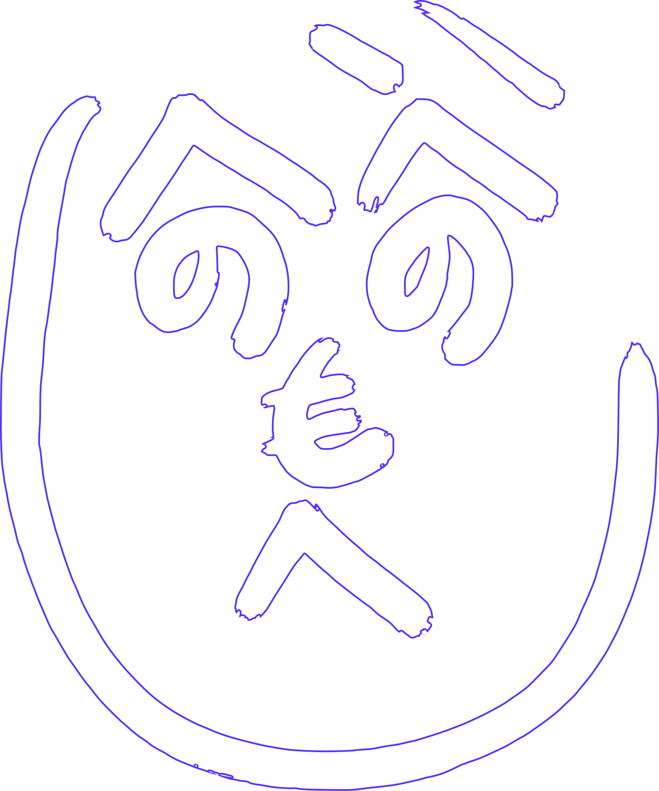
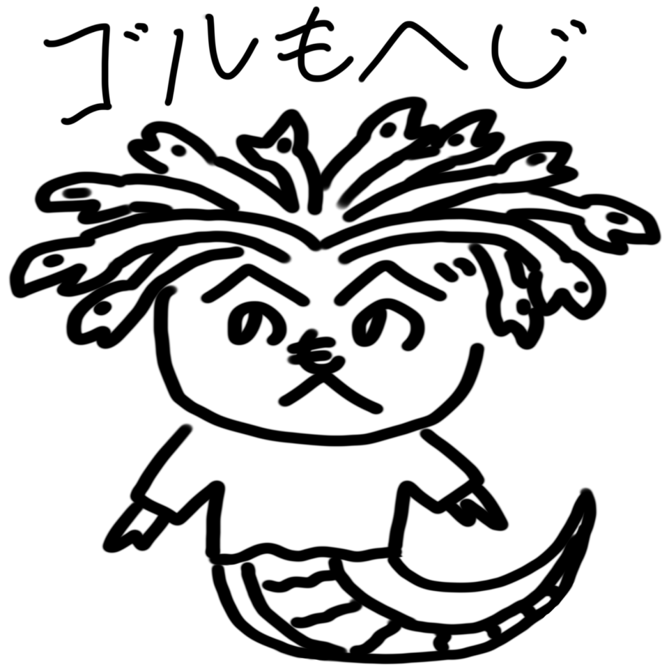
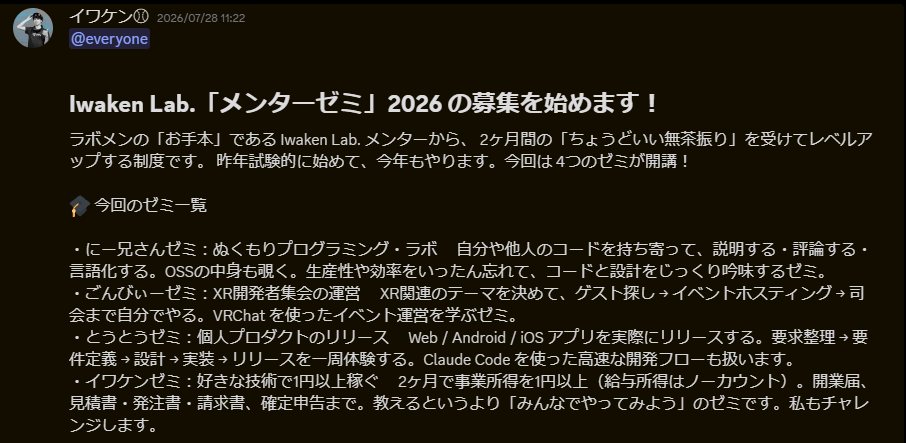
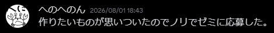
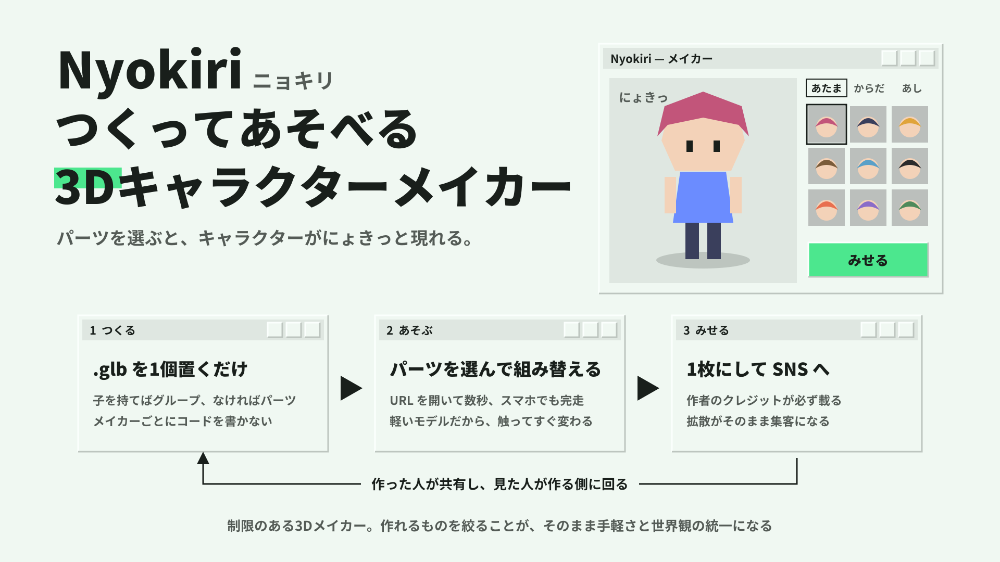
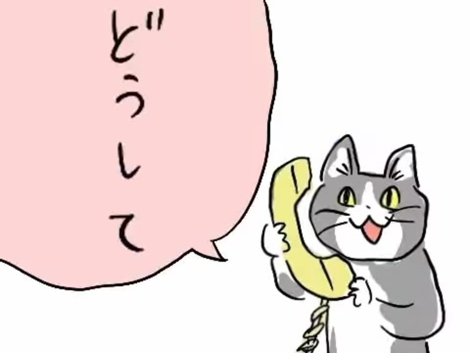
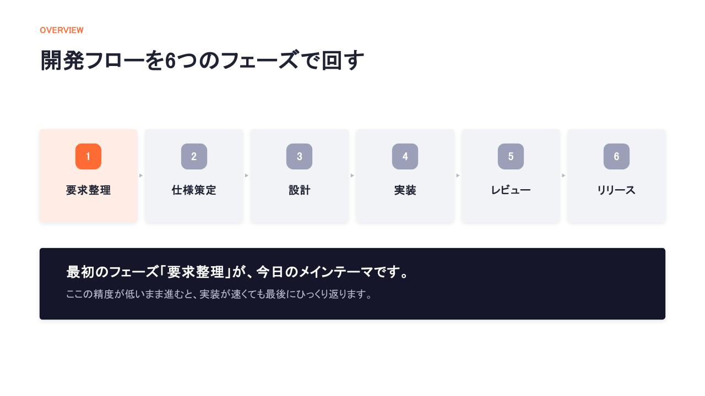
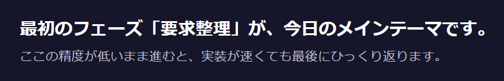
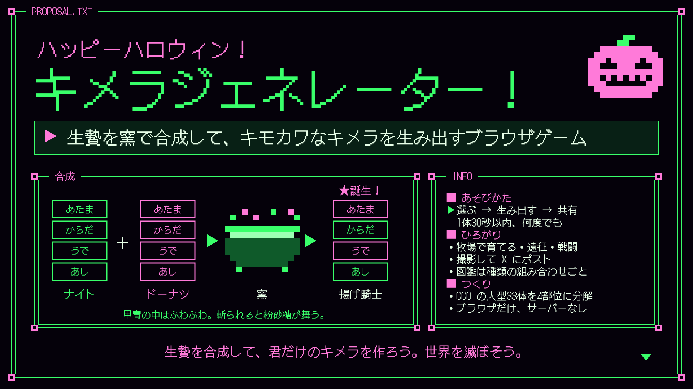

# 要求定義無理すぎた話

<!-- _class: title -->

Iwaken Lab. メンターゼミ成果発表会

---

# へのへのん

<!-- _class: me -->

- とうとうゼミ
- 普段はゲームとか作ってる
- はっぴーはろうぃん

---

# 参加経緯

ゼミ、良いな...！

んーでも余裕あるかな～ピンと来ていない。

---

# 参加経緯

ゼミ、良いな...！

んーでも余裕あるかな～ピンと来ていない。

---

# ！

<!-- _class: message -->

---

# きかくしょ

<!-- _class: message -->

---

# 今回作ったもの

<!-- _class: message -->

<video src="images/toutou-zemi/chimera-pv.mp4" poster="images/toutou-zemi/chimera-pv.jpg" height="480" controls></video>

---

# 今回作ったもの

<!-- _class: message -->

<video src="images/toutou-zemi/chimera-pv.mp4" poster="images/toutou-zemi/chimera-pv.jpg" height="360" controls></video>

ゲームやないか

---

# どうして

---

# どうして

## 目的がない

- VRChat → VRoid Studio / Booth
- SNS → Picrew / Pixiv
- ゲーム開発 → Asset Store / Poly Pizza

---

# どうして

## 目的がない

- VRChat → VRoid Studio / Booth
- SNS → Picrew / Pixiv
- ゲーム開発 → Asset Store / Poly Pizza

→ イマイチクリティカルに刺せる層がいない。

---

# 要求定義(整理)

<!-- _class: message -->

by とうとうゼミキックオフ

---

# 要求定義(整理)

<!-- _class: message -->

---

# 何とかなれー

- トラッキング
- デスクトップアプリ
- 写真隠し

---

# 何とかなれー

- トラッキング
- デスクトップアプリ
- 写真隠し

## →無理やな

---

# まぁ～～ゲームか

<!-- _class: message -->

---

# まとめ

- 要求定義難しかった～
  - サービス～～～
  - 入りが好奇心すぎた
- 苦手なもんは苦手やな
  - 結局ゲームや...
  - 計画的な開発～

---

# 精進します

<!-- _class: big -->

thank you for listening.
